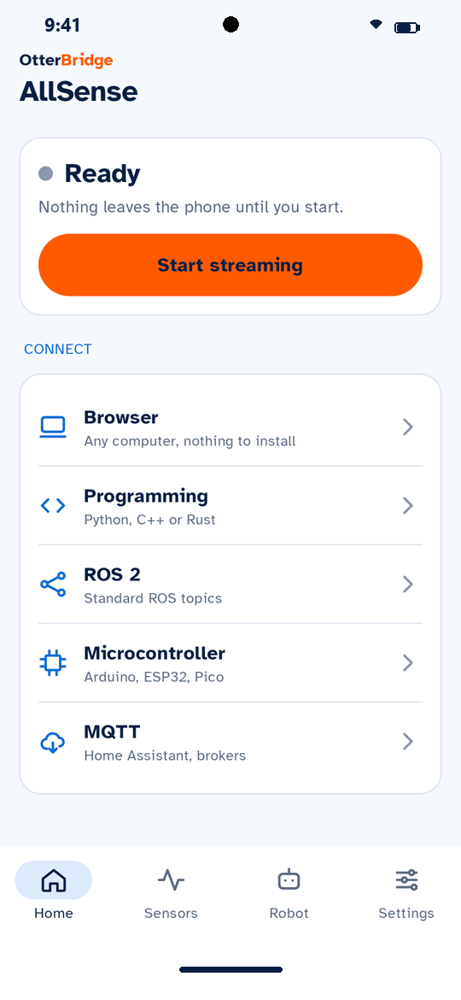
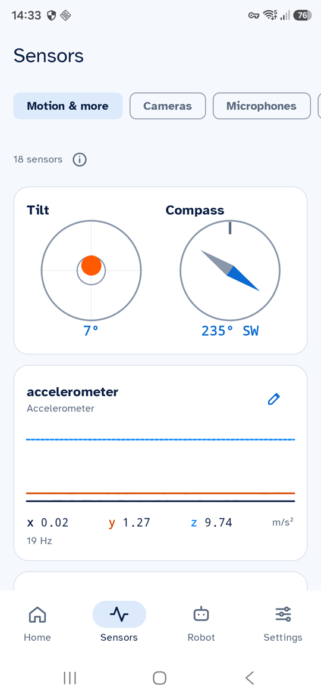
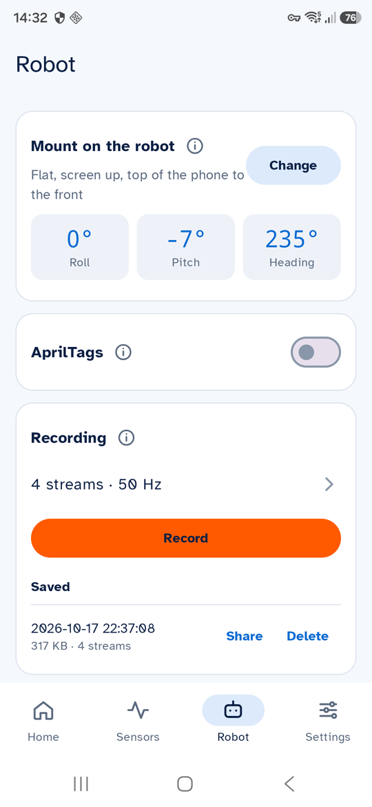

<h1 align="center">AllSense by OtterBridge</h1>

<b>Turn an Android phone, even an old one, into a sensor hub for your robot.</b>

  <a href="https://github.com/wen-da-ng/otterbridge-allsense/releases/latest"><b>Download the app</b></a> ·
  <a href="https://docs.allsense.otterbridge.org/"><b>Docs</b></a> ·
  <a href="https://docs.allsense.otterbridge.org/get-started/">Get started</a> ·
  <a href="https://github.com/wen-da-ng/otterbridge-allsense/issues">Report a problem</a>

  <picture><source media="(prefers-color-scheme: dark)" srcset="images/dark/home-hero.png"></picture>
  <picture><source media="(prefers-color-scheme: dark)" srcset="images/dark/sensors.png"></picture>
  <picture><source media="(prefers-color-scheme: dark)" srcset="images/dark/robot.png"></picture>

A phone in a drawer has an IMU, a compass, GPS, several cameras, microphones, a barometer and radios. AllSense finds all of them, lets you name the ones you want, and streams them to your robot.

- **Finds everything:** motion and environment sensors, every camera and lens, microphones, GNSS with a sky plot, Wi-Fi, Bluetooth, cellular, battery.
- **Streams it** over Wi-Fi, a USB cable or Bluetooth LE: to a browser, Python, C++, Rust, ROS 2, Arduino/ESP32 boards and MQTT.
- **For robots:** motion in the robot's axes once you say how the phone is mounted, AprilTag detection, recordings, and the phone's screen, speaker and vibration on command.
- **Private by default:** nothing leaves the phone until you tap **Start streaming**, and you choose what each link may see.

## Get the app

1. Any phone with **Android 12 or newer**.
2. Download the APK from the [latest release](https://github.com/wen-da-ng/otterbridge-allsense/releases/latest) and open it on the phone. Allow installing from your browser or files app when Android asks.
3. Tap **Start streaming**, then follow **Home → Connect** for your robot.

Each release lists the APK's SHA-256 and the signing certificate, so you can check what you install.

## Connect your robot

| You have | Use | Docs |
|---|---|---|
| Any computer with a browser | The built-in dashboard, nothing to install | [Browser](https://docs.allsense.otterbridge.org/get-started/browser/) |
| Python | [otterbridge-allsense-python](https://github.com/wen-da-ng/otterbridge-allsense-python) | [Python](https://docs.allsense.otterbridge.org/get-started/python/) |
| C++ | [otterbridge-allsense-cpp](https://github.com/wen-da-ng/otterbridge-allsense-cpp) | [C++](https://docs.allsense.otterbridge.org/get-started/cpp/) |
| Rust | [otterbridge-allsense-rust](https://github.com/wen-da-ng/otterbridge-allsense-rust) | [Rust](https://docs.allsense.otterbridge.org/get-started/rust/) |
| ROS 2 | [otterbridge-allsense-ros2](https://github.com/wen-da-ng/otterbridge-allsense-ros2) | [ROS 2](https://docs.allsense.otterbridge.org/get-started/ros2/) |
| Arduino, ESP32, Pico | [otterbridge-allsense-arduino](https://github.com/wen-da-ng/otterbridge-allsense-arduino) | [Microcontroller](https://docs.allsense.otterbridge.org/get-started/board/) |
| An MQTT broker, Home Assistant | Built into the app | [MQTT](https://docs.allsense.otterbridge.org/get-started/mqtt/) |

## Build on it

- [otterbridge-allsense-protocol](https://github.com/wen-da-ng/otterbridge-allsense-protocol): the protocol spec and a test kit with stand-in phones, so you can write a client in any language and test it without a phone.
- [otterbridge-allsense-starters](https://github.com/wen-da-ng/otterbridge-allsense-starters): starters for frame templates (a board with its own serial protocol) and programs that use the phone's streams.
- [otterbridge-allsense-docs](https://github.com/wen-da-ng/otterbridge-allsense-docs): the source of the docs site.

The protocol, the test kit, the libraries, the starters and the docs are open source (MIT). The app itself is closed source; its releases are published here.

## Problems and ideas

- **The app:** [open an issue](https://github.com/wen-da-ng/otterbridge-allsense/issues/new/choose) in this repository.
- **A library or the protocol:** open it in that library's repository.
- **A security problem:** please report it privately, see [SECURITY](https://github.com/wen-da-ng/.github/blob/main/SECURITY.md).

---

The OtterBridge and AllSense names, the logo and the screenshots are © 2026 wen-da-ng. All rights reserved.
